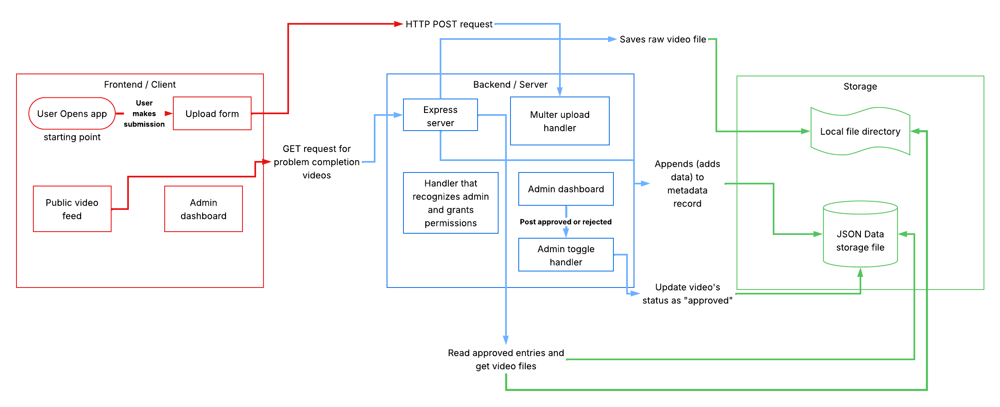

# Project Name

Web application where users can upload videos of themselves completing boulder problems on Purdue's rock wall in the CoRec

## The Problem

Most large climbing gyms are connected to an app called Kaya, which allows members to browse videos of people completing problems (climbs) at their specific gym. Purdue's rock wall does not have something like this, which could lead to difficulties if someone is stuck or confused on how to complete a bouldering problem.

## How It Works



## Tech Stack

- **Language:** JavaScript, Node.js, Html/CSS/JS
- **Libraries:** Express.js, Multer
- **Storage:** JSON file (`submissions.json`)

## Setup

```bash
git clone https://github.com/DanielStenbakken/BoilerBoulder
cd BoilerBoulder
npm install
```

## Usage

```bash
npm start
```
Now open your browser and navigate to:http://localhost:3000

## Roadmap

- [ ] User profiles with problem completion history
- [ ] Filtered Search (search by grade, setter, etc)

## Author

Daniel Stenbakken, https://github.com/DanielStenbakken